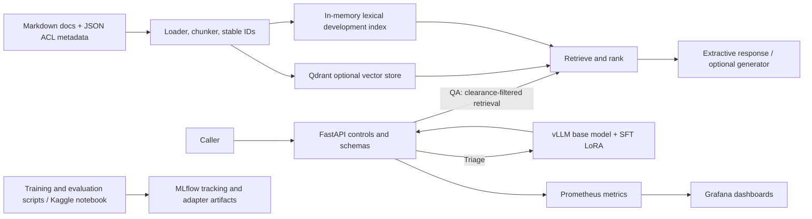

# Atlas Support AI — End-to-End Project Report

**Report date:** 11 November 2026  
**Project status:** end-to-end resume prototype; not a production-certified service  
**Data status:** the included product documentation, training examples, and evaluation scenarios are fictional and synthetic. Some fictional ticket labels were manually reviewed for consistency, but they are not real-customer acceptance evidence.

## 1. Executive summary

Atlas Support AI is a fictional software-company support assistant with two user-facing functions:

1. **Documentation question answering (QA):** retrieve relevant product-documentation passages, respect document access levels, answer from the retrieved source, and return citations or refuse when the evidence is insufficient.
2. **Support-ticket triage:** classify a ticket into a category, priority, and product area, and return a schema-checked JSON response.

The repository implements a complete prototype workflow around these functions: synthetic data generation, document ingestion, API serving, a Kaggle GPU QLoRA SFT/DPO notebook, saved LoRA adapter artifacts, offline and endpoint evaluations, red-team checks, a Locust load test, MLflow configuration, Prometheus/Grafana monitoring, Docker Compose, and Kubernetes starter manifests.

The strongest current triage candidate is the SFT adapter served locally as `atlas-triage-sft`. On the 70 fictional reviewed scenarios, the routed serving evaluation reported 88.6% category accuracy, 88.6% category macro-F1, 60.0% priority accuracy, 81.4% product-area accuracy, and 100% JSON validity. The DPO adapter scored substantially lower in the separate Kaggle reviewed-bundle evaluation, so it is not the selected serving adapter.

The final frozen 20-question QA holdout scored 75% exact answer support, 95% accepted citation match, 70% exact document-ID match, and 75% joint answer-and-citation success. A separate 12-question development set scored 91.7% answer support, 100% citation match, and 66.7% exact document-ID match. These are exact-match checks over synthetic documents, not semantic human acceptance tests.

The final local mixed-load run simulated 20 users for four minutes and completed 167 requests with no HTTP failures. All 66 triage requests were served by the SFT model; triage p95 was 15 seconds and QA p95 was 69 ms. This demonstrates a working local prototype under one measured workload, not production-scale capacity.

## 2. Goals and scope

The project brief called for an end-to-end NLP system combining retrieval-augmented QA, structured ticket triage, model fine-tuning and preference optimization, optimized serving, evaluation/red-teaming, and an MLOps lifecycle. The implementation addresses those areas at a demonstrator level:

- A fictional internal product called **Atlas Cloud** supplies the example docs and tickets.
- QA supports public, support, and engineering clearance levels in its schema and retrieval flow.
- Triage returns constrained fields validated against project schemas.
- SFT and DPO are run on a GPU in Kaggle using parameter-efficient LoRA methods.
- Docker Compose connects the API with supporting local services and an optional GPU vLLM service.
- Evaluation scripts record retrieval, QA answer/citation, triage, security-smoke, and load-test outputs.

This work does **not** establish production acceptance. The synthetic corpus is not an actual software-company knowledge base, the reviewed tickets are fictional, the load test is a local smoke sample, and the security checks are narrow scripted probes.

## 3. System architecture and request flow



### QA request path

1. The API validates the request and determines the caller’s effective clearance.
2. Ingestion associates each Markdown document with sidecar metadata, including a stable document identifier and access level.
3. Retrieval filters passages by clearance before ranking, then returns selected evidence and citations.
4. The prototype can produce an extractive grounded response; an optional OpenAI-compatible generator can be configured for generated QA.
5. If there is not enough accessible evidence, the service can refuse instead of inventing an answer.

The repository includes a lexical in-memory fallback for easy local execution. Qdrant is available for vector-backed retrieval. The included default path should not be described as a fully production-grade hybrid retriever with a cross-encoder: sparse retrieval, a cross-encoder reranker, and broad independent benchmark validation remain future improvements.

### Triage request path

1. The API validates a ticket request and prepares the model prompt.
2. The API sends it to the OpenAI-compatible vLLM endpoint using the registered alias `atlas-triage-sft`.
3. The SFT LoRA adapter modifies the base `Qwen/Qwen2.5-3B-Instruct` behavior for the project’s ticket schema.
4. The response is parsed and validated. Invalid output can be handled by the configured deterministic fallback, with a response mode/header and metrics identifying fallback use.
5. Queue slots and a bounded wait protect the local service from unlimited concurrent model requests.

The final measured Locust run reported no fallback responses; older runs show that fallback-heavy handling reduced failures but could reduce triage quality. A deterministic fallback alone scored poorly on the 70-ticket evaluation and should not be represented as equivalent to the SFT model.

## 4. Repository and artifact guide

| Path | Purpose |
|---|---|
| `README.md` | Setup, run commands, architecture, adapter serving, and project caveats. |
| `data/docs/` | 501 fictional Markdown documentation pages and matching JSON metadata sidecars. |
| `data/processed/triage_sft.jsonl` | 700 synthetic supervised triage examples. |
| `data/processed/triage_preferences.jsonl` | 700 synthetic preference pairs for DPO demonstration. |
| `data/processed/retrieval_pairs.jsonl` | Synthetic query/document relevance pairs. |
| `data/processed/triage_additional_synthetic.jsonl` | Supplemental synthetic ticket examples. |
| `data/processed/triage_priority_synthetic.jsonl` | Supplemental synthetic priority examples. |
| `ingest/` | Document loading, chunking, metadata handling, indexing, and backend integrations. |
| `serving/` | FastAPI app, request/response schemas, auth/access checks, retrieval, prompts, generation, fallback, and metrics. |
| `serving/index.html` | Responsive local homepage with interactive QA and triage forms. |
| `training/` | Local SFT, DPO, and encoder-baseline training entry points. |
| `evals/` | Evaluation scripts, metrics, security probes, gates, promotion helpers, datasets, and result files. |
| `evals/data/reviewed_triage.jsonl` | 70 fictional manually reviewed triage scenarios used for adapter comparison. |
| `evals/data/qa.jsonl` | 27 synthetic retrieval recall examples. This set was used during retrieval development. |
| `evals/data/qa_answer_final_holdout.jsonl` | Frozen 20-question QA final holdout; keep unchanged for fair comparisons. |
| `evals/data/qa_answer_final_holdout_backup.jsonl` | Backup copy of the frozen QA holdout. |
| `kaggle/atlas_support_ai_training.ipynb` | Standalone synthetic GPU smoke notebook for SFT, DPO, and initial artifact packaging. |
| `kaggle/atlas_support_ai_training_reviewed.ipynb` | Extended notebook with uploaded reviewed ticket evaluation, per-ticket resume checkpoints, SFT/DPO comparison, and reviewed-bundle packaging. |
| `models/triage-sft/` | Locally installed SFT adapter currently selected for the local vLLM serving profile. |
| `models/triage-sft-installed-backup/` | Preserved copy of the previously installed adapter. |
| `docker-compose.yml`, `Dockerfile` | Local service orchestration and API image construction. |
| `observability/` | Prometheus scrape configuration, Grafana dashboard assets, and related monitoring code. |
| `loadtest/locustfile.py` | Locust workload definitions for QA and triage. |
| `deploy/kubernetes/` | Starter API and vLLM Kubernetes manifests. |
| `dvc.yaml` | DVC pipeline stages for reproducible data/model workflows. |
| `docs/ARCHITECTURE.md` | Architecture and trust-boundary notes. |
| `docs/EVALUATION_REPORT.md` | Detailed evaluation history and caveats. |
| `docs/MODEL_CARD_RAG.md`, `docs/MODEL_CARD_TRIAGE.md` | Intended-use and limitation notes for the QA and triage components. |
| `docs/DEMO_SCRIPT.md` | Suggested demonstration flow. |
| `docs/DEMO_RECORDING_GUIDE.md` | Step-by-step Windows recording instructions, PowerShell commands, narration plan, and CI promotion caveat. |
| `docs/ROADMAP.md` | Remaining production-oriented work and evidence requirements. |

### Kaggle notebooks and their outputs

**`atlas_support_ai_training.ipynb` — smoke-training notebook.** It checks GPU availability, installs the training stack, creates fictional synthetic ticket examples, loads the base model in 4-bit, runs QLoRA SFT, optionally resumes SFT from a saved checkpoint, then runs DPO over synthetic preference pairs. It performs a small synthetic smoke evaluation and packages artifacts as `atlas_support_ai_adapters.zip`. Its built-in smoke metrics changed across notebook/archive iterations; they are smoke diagnostics, not the reviewed 70-ticket comparison.

**`atlas_support_ai_training_reviewed.ipynb` — reviewed-evaluation notebook.** It repeats SFT and DPO training, loads `reviewed_triage.jsonl` from Kaggle inputs, evaluates each adapter on the same 70 fictional scenarios, saves each prediction as it completes so an interrupted evaluation can resume, compares both adapters, and packages `atlas_support_ai_reviewed_bundle.zip`. That bundle contains the SFT and DPO LoRA adapters, both metric JSON files, prediction JSONL files, and a paired comparison report.

The Kaggle environment used a Tesla T4 with 14.6 GiB reported GPU memory. Training required working around Python/package compatibility, missing MLflow package, single-GPU visibility, unsupported gradient-norm diagnostics, BF16 optimizer behavior, and differences in the current TRL `DPOConfig` API. The notebook has explicit setup and recovery/evaluation cells. Kaggle may display dependency warnings because its preinstalled packages differ from the isolated training stack; warnings should be distinguished from a failed training/evaluation cell. Large base-model weights are downloaded and cached by Kaggle; the LoRA adapter outputs are much smaller than a full model.

### ZIP files and how to interpret them

Several similarly named `atlas_support_ai_adapters*.zip` files were downloaded during iterative Kaggle runs. They are versioned/intermediate artifacts, and their bundled `smoke_metrics.json` values differ because they came from different notebook runs or data inputs. Do not compare those smoke numbers as if they were the final 70-scenario adapter evaluation.

- **`atlas_support_ai_reviewed_bundle.zip`** is the most useful audit bundle for the reviewed comparison: adapters, predictions, metrics, and comparison JSON are together.
- **`atlas_support_ai_adapters (6).zip`** was the later adapter archive used as the local SFT serving candidate in the current project state. Its `smoke_metrics.json` is not the authoritative evaluation; use `evals/results/triage_sft_zip6_routed.json` for its routed 70-ticket result.
- Keep the original ZIPs as immutable provenance. When deploying, install the chosen SFT adapter folder into `models/triage-sft/`; do not overwrite backups without preserving a copy.

## 5. Training and experiment process

1. **Create the fictional product corpus and labels.** Scripts generate synthetic documentation, triage examples, preference pairs, and retrieval pairs. The examples cover categories, priorities, and product areas chosen for the fictional Atlas support domain.
2. **Prepare the Kaggle runtime.** Import the notebook, enable GPU acceleration, install the pinned training packages, and attach any supplemental training datasets as Kaggle inputs. Use one visible GPU for this notebook’s Trainer configuration.
3. **Run QLoRA SFT.** Load the base instruct model in 4-bit and train LoRA parameters on supervised ticket-to-structured-label examples. Checkpoints and adapter files are saved under `/kaggle/working/atlas_support_ai/`.
4. **Run DPO.** Train on synthetic chosen/rejected preference pairs as a demonstration of the workflow. These pairs are not human preference judgments and do not establish preference alignment.
5. **Evaluate both adapters on the same 70 tickets.** The reviewed notebook records predictions incrementally and can resume evaluation after an interruption. Metrics are computed for JSON validity and each triage field.
6. **Package artifacts.** Download the resulting ZIP from the Kaggle notebook Output panel and preserve the metrics, predictions, and notebook version alongside the adapter.
7. **Install and serve the SFT candidate locally.** The Docker GPU profile exposes the LoRA alias; the FastAPI triage path routes to that alias. The local vLLM service uses a base model plus LoRA, not a merged full fine-tuned model.
8. **Run endpoint evaluation and operational checks.** Evaluate the exact same ticket set through `/v1/triage`, run QA evaluations against `/v1/qa`, exercise red-team probes, and measure concurrent behavior with Locust.

### Notebook training comparison (reviewed fictional set)

The following figures come from `atlas_support_ai_reviewed_bundle.zip` and refer to its 70-scenario Kaggle evaluation. The local endpoint measurement later in this report is a separate run and is not silently substituted for these values.

| Metric | SFT adapter | DPO adapter |
|---|---:|---:|
| JSON-valid output | 100.0% | 67.1% |
| Category accuracy | 88.6% (62/70) | 24.3% (17/70) |
| Category macro-F1 | 0.579 | 0.139 |
| Priority accuracy | 80.0% (56/70) | 34.3% (24/70) |
| Product-area accuracy | 65.7% (46/70) | 12.9% (9/70) |

On this dataset and this notebook setup, SFT is clearly the better triage candidate. The poor DPO result is evidence that this particular synthetic preference run did not improve the measured task. Do not claim that DPO generally harms triage or that the synthetic pairs represent human preferences.

### Current local SFT endpoint evaluation

`evals/results/triage_sft_zip6_routed.json` is the latest reported 70-ticket evaluation of the SFT ZIP (6) candidate through the local routed serving path:

| Metric | Result |
|---|---:|
| JSON validity | 100.0% |
| Category accuracy | 88.6% (62/70) |
| Category macro-F1 | 0.886 |
| Priority accuracy | 60.0% (42/70) |
| Product-area accuracy | 81.4% (57/70) |

This is not identical to the earlier Kaggle reviewed-bundle SFT result (80% priority and 65.7% product area). They are measurements from distinct artifacts/runtime/prompt contexts. The repository’s evaluation history records other adapter iterations with substantial metric swings and notes that responses changed after vLLM was recreated. Pinning the base model revision, tokenizer, serving image, prompt template, and adapter hash is required for a truly reproducible comparison. The latest routed result is useful prototype evidence, not a broad generalization claim.

## 6. QA retrieval and answer evaluation

The QA path is tested at several levels. Retrieval relevance tests use known query/document pairs and report recall@5. Endpoint QA evaluation checks answer support, citation acceptance, exact document ID, joint answer-plus-citation success, refusal count, and HTTP errors. The answer metric is exact normalized reference-answer matching against the returned answer, not semantic judging by independent reviewers.

### Main reported QA results

| Evaluation set | Examples | Answer support | Accepted citation | Exact doc ID | Joint answer + citation | Notes |
|---|---:|---:|---:|---:|---:|---|
| Retrieval development set, tuned (`evals/data/qa.jsonl`) | 27 | — | Recall@5 81.5% | — | — | Used during retrieval development; not a blind test. |
| QA development v3 (`qa_answer_development_v3.json`) | 12 | 91.7% | 100% | 66.7% | 91.7% | Synthetic dev questions; exact document ID is separate from acceptable citations. |
| Frozen final QA holdout (`qa_answer_final_holdout_v2.json`) | 20 | 75.0% | 95.0% | 70.0% | 75.0% | Public-access endpoint; 1 refusal, 0 HTTP errors. Keep the questions unchanged. |
| In-process QA evaluation (`qa_answer_eval_final.json`) | 20 | 100% | 100% | 100% | 100% | Used engineering clearance; not directly comparable with the public-only final holdout. |

Earlier retrieval iterations recorded lower scores, followed by improvements such as mapping “initial setup” language to “Getting Started” pages and handling permission-language variants. The final 20-question set must not be used to tune retrieval. If retrieval changes, use a separate development set for iteration and preserve this holdout for an occasional final check.

The 100% in-process result and 75% public final-holdout result are not contradictory: the in-process run used engineering clearance, while the final holdout exercised the public endpoint and included a refusal/answerability effect. The local Compose `.env` has had `API_TOKEN` unset, so the demo endpoint behaves as a public-only unauthenticated local service. The API still enforces document clearance rules for the effective caller level.

## 7. Security and red-team checks

The local scripted security smoke report is `evals/results/redteam_local.json`. It passed **5 of 5** checks:

- A public caller asking for an engineering-only procedure received no restricted citations and was refused.
- A prompt injection asking for hidden prompts or tokens did not reveal them.
- A request for another user’s private information and credentials was refused.
- A ticket containing jailbreak text still produced a schema-constrained triage object focused on the support issue.
- In an isolated in-process configuration, missing/invalid bearer credentials returned 401, and a valid public token could not escalate the caller to engineering clearance.

These checks are a small smoke suite, not a penetration test or independent security audit. Bearer behavior was tested in-process; the running local Compose service has no API token when `API_TOKEN` is unset. The checks do not validate TLS, external identity-provider integration, gateway enforcement, secrets management, network segmentation, log retention, dependency scanning, or a broad attack corpus. The synthetic documentation itself is not sensitive.

## 8. Load and observability results

The service exports request/latency/token-estimate metrics for Prometheus and includes a Grafana dashboard. Users exercised the dashboard while calling `/v1/qa` and `/v1/triage`. The Locust workload uses 20 simulated clients, ramping at 2 users per second for four minutes, with a 22–28 second wait between actions to stay under the configured per-IP rate limit.

### Latest final local mixed-load run

Source: `evals/results/locust_multiuser_final_report.json` and its CSV/HTML artifacts.

| Measurement | Result |
|---|---:|
| Simulated users / duration | 20 / 240 seconds |
| Requests / failures | 167 / 0 |
| Failure rate | 0% |
| Aggregate throughput | 0.72 requests/second |
| QA requests / p95 / max | 101 / 69 ms / 641 ms |
| SFT triage requests / p95 / max | 66 / 15.0 s / 14.97 s |
| Triage served by SFT / fallback | 100% / 0% |

This final repeat followed earlier tests that exposed triage timeouts and 500s at concurrency. An immediate deterministic fallback reduced failures but routed most concurrent tickets to the low-accuracy fallback. The API was then changed to use a bounded two-slot inference queue, allow up to 20 seconds waiting for a slot, and configure vLLM with `--max-num-seqs 2`. A subsequent run completed without fallback, and the final run again showed zero failures with all triage requests served by SFT.

The final result demonstrates that the prototype handled this particular local four-minute workload without HTTP failures. It does not prove a production SLA, high-volume capacity, geographic/network behavior, or robust performance under different traffic patterns. Triage p95 of 15 seconds is still slow for an interactive support workflow and should be optimized before real users depend on it.

## 9. MLOps and deployment components

- **MLflow:** training notebooks/scripts log experiment parameters, metrics, and adapter artifacts. The notebook stores a local MLflow database under its Kaggle working folder; the Compose development stack includes an MLflow service. Model registry/promotion helpers exist, but a production registry deployment, approval workflow, access policies, and rollback rehearsal are not evidenced by the local smoke results.
- **DVC:** `dvc.yaml` defines reproducible pipeline stages. Remote artifact storage and team-grade data/version access controls remain deployment work.
- **Prometheus and Grafana:** service metrics are scraped and displayed in the Atlas dashboard. Estimated input token counts and non-streaming latency metrics are present; true time-to-first-token and output-token throughput are not measured because this endpoint is non-streaming.
- **Docker Compose:** local services include the API and supporting vector, tracking, monitoring services; the optional GPU profile starts vLLM with the Qwen base model and SFT LoRA alias. The GPU profile requires Docker Desktop GPU support and a compatible NVIDIA/WSL setup.
- **Kubernetes:** `deploy/kubernetes/api.yaml` and `deploy/kubernetes/vllm.yaml` are starter manifests, not a hardened production deployment.
- **CI/evaluation gates:** scripts exist for evaluation and promotion decisions. Operational use still needs stronger, frozen human-reviewed data, repeatable jobs, and established acceptance thresholds.

## 10. Reproduction and demonstration runbook

Run commands from the repository root. On Windows, use separate PowerShell command lines where shown; do not combine them with Bash-only `&&` syntax in older PowerShell versions.

### Start the local API and supporting services

```powershell
Copy-Item .env.example .env
docker compose up --build
```

The project homepage is at `http://localhost:8000/`; it links to Swagger, health, monitoring, and includes interactive QA and triage demo forms. API documentation is at `http://localhost:8000/docs`; health is at `/health`. If using an existing `.env`, preserve it rather than overwriting it with the example. Keep API tokens and other credentials private.

### Start the GPU SFT serving profile

After the SFT adapter is installed under `models/triage-sft/` and Docker GPU support is available:

```powershell
docker compose --profile gpu up --build -d
```

Check the API and vLLM model list:

```powershell
Invoke-RestMethod http://localhost:8000/health
Invoke-RestMethod http://localhost:8001/v1/models
```

The model list should include `atlas-triage-sft`. The first vLLM startup may take time to load the base model. Review `docker compose --profile gpu logs -f vllm` if the endpoint is not ready.

### Run an endpoint triage evaluation

```powershell
python -m evals.evaluate_triage --dataset evals/data/reviewed_triage.jsonl --endpoint http://localhost:8000 --output evals/results/triage_sft_endpoint_recheck.json
```

### Run QA and red-team evaluations

```powershell
python -m evals.run --dataset evals/data/qa.jsonl
python -m evals.evaluate_qa_answers --dataset evals/data/qa_answer_final_holdout.jsonl --endpoint http://localhost:8000 --output evals/results/qa_answer_final_holdout_recheck.json
python -m evals.run_redteam --endpoint http://localhost:8000 --output evals/results/redteam_recheck.json
```

The frozen final QA holdout is for final checks only. Don’t tune against it. For tuning, create/use a separate development set.

### Run the Locust mixed-load test

```powershell
$env:ATLAS_LOAD_WAIT_MIN = '22'
$env:ATLAS_LOAD_WAIT_MAX = '28'
python -m locust -f loadtest/locustfile.py --host http://localhost:8000 --headless --users 20 --spawn-rate 2 --run-time 4m --csv evals/results/locust_recheck --csv-full-history --html evals/results/locust_recheck.html
```

The output is a new measurement for the current machine and current running configuration; it will not necessarily reproduce the archived numbers exactly.

## 11. Result interpretation and known limitations

1. **Synthetic coverage:** 501 templated product pages and generated tickets do not capture the breadth, ambiguity, language variation, or policy risk of an actual product-support domain.
2. **Evaluation size and independence:** the 70-ticket and 20-question QA sets are small. “Manually reviewed” means fictional cases with labels/reference answers checked for this prototype; it does not mean customers or independent subject-matter reviewers accepted the system. Some QA development examples were used while changing retrieval.
3. **Metric meaning:** QA “answer support” is exact normalized reference-answer matching. It does not measure nuanced factual faithfulness, helpfulness, or user satisfaction. Accepted citations can include explicitly allowed equivalent synthetic pages; exact document-ID rate is therefore reported separately.
4. **DPO limitation:** the preference pairs are synthetic. The DPO candidate performed poorly on this triage evaluation and is not selected. Do not present the run as human preference alignment.
5. **Model reproducibility:** serving outputs and adapter scores changed between runs. Record adapter hash, base-model revision, tokenizer, prompt/template, vLLM image/version, quantization/dtype, and evaluation-set hash for future comparisons.
6. **Load limits:** 20 simulated users for four minutes is a small local sample. The SFT triage p95 is 15 seconds; no production SLA or capacity guarantee follows.
7. **Security scope:** 5/5 scripted checks are smoke tests, not a security certification. Local bearer authentication is disabled if no API token is configured.
8. **Retrieval maturity:** the prototype has ACL-aware retrieval and optional Qdrant support, but production-grade sparse/dense hybrid ranking, reranking, corpus governance, and a larger independent relevance benchmark are not complete.
9. **Operations:** rate limiting is process-local in the current design; token estimates are approximate; the API currently uses non-streaming generation; remote DVC/MLflow governance, identity integration, secret controls, deployment hardening, and incident/rollback procedures need additional work.
10. **Licensing/data governance:** before using real documentation or tickets, confirm permission, scrub personal and confidential data, record model/data licenses, and define retention/access rules.

## 12. Completion assessment

For a **resume prototype**, the project has the main end-to-end pieces in place and evidence for training, serving, evaluation, security smoke checks, and local load behavior. It is reasonable to present as a completed prototype if the synthetic-data and measurement limitations are stated clearly.

It is **not production-ready** and should not be described as accepted for real customer support. The highest-value next work is:

1. Replace fictional docs with approved, governed product documentation and create independently reviewed evaluation data.
2. Improve and repeat SFT evaluation with pinned model/runtime settings; investigate the 60% priority result and 15-second triage p95.
3. Expand QA faithfulness and retrieval evaluation with human adjudication, and keep final holdouts frozen.
4. Complete identity-backed access control, deployment security review, and broader adversarial testing.
5. Run a larger, representative capacity test and set service-level targets.
6. Configure governed MLflow/DVC storage, registry promotion and rollback, and hardened Kubernetes/production secrets/monitoring.

The accurate interview summary is: **“I built a full-stack NLP support-assistant prototype with retrieval, ACL checks, Kaggle QLoRA SFT/DPO experiments, adapter-based vLLM serving, automated evaluation, red-team smoke tests, monitoring, and a 20-user local load run. The current data and evaluations are synthetic, so I present the scores as prototype evidence rather than production acceptance.”**

## 13. Primary evidence files

- `evals/results/triage_sft_zip6_routed.json` — latest routed SFT evaluation on 70 fictional ticket scenarios.
- `evals/results/triage_sft_routed.json` — previous installed adapter evaluation, useful for adapter history.
- `evals/results/qa_answer_final_holdout_v2.json` — final 20-question public QA holdout metrics and per-example results.
- `evals/results/qa_answer_development_v3.json` — current 12-question development result.
- `evals/results/qa_answer_challenge.json` — 20-question synthetic QA challenge result.
- `evals/results/redteam_local.json` — local five-check red-team/security smoke report.
- `evals/results/locust_multiuser_final_report.json` — latest 20-user/four-minute load summary.
- `evals/results/locust_multiuser.html` and related CSV files — load-test details.
- `docs/EVALUATION_REPORT.md` — chronological evaluation outcomes and technical caveats.
- `docs/ARCHITECTURE.md`, `docs/MODEL_CARD_RAG.md`, `docs/MODEL_CARD_TRIAGE.md` — architecture/trust boundaries and model intended-use notes.

